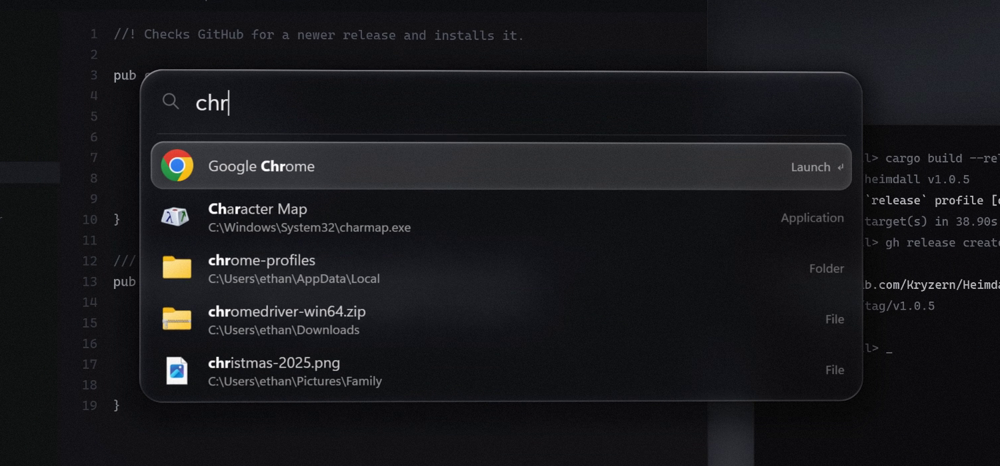

<p align="center">
  
</p>

<h1 align="center">Heimdall</h1>

<p align="center">
  A fast, tiny launcher for Windows.<br>
  <a href="https://github.com/Kryzern/Heimdall/releases/latest">Download</a> · <a href="https://github.com/Kryzern/Heimdall/releases">Changelog</a>
</p>

<p align="center">
  
</p>

Press <kbd>Alt</kbd> + <kbd>Space</kbd>, type a few letters, hit Enter. Heimdall finds your apps, files on every drive, Windows settings and open windows, does quick maths and web searches, and gets out of the way. It's two native executables, under 2 MB together, no Electron or .NET.

I'd been on Flow Launcher for about a year and a half and wanted something lighter that still looked good, so I made this :)

## Install

Grab `Heimdall-x.y.z-x64-setup.exe` from the [latest release](https://github.com/Kryzern/Heimdall/releases/latest) and run it. Windows asks for admin once, that's for the file indexer service, which reads the NTFS file table directly so file search is instant. Saying no is fine, Heimdall indexes on its own then.

Or with Scoop:

```powershell
scoop bucket add heimdall https://github.com/Kryzern/Heimdall
scoop install heimdall/heimdall
```

There's also a portable zip on the release page, with `install.ps1` and `uninstall.ps1` inside. Uninstall the normal way from Settings > Apps.

## Using it

| Type | |
|---|---|
| `chr`, `vsc` | Apps by prefix or acronym |
| `report ext:pdf`, `holiday type:image` | Files, with filters like `in:`, `size:>100mb`, `mod:week`, `-in:node_modules` |
| `bluetooth`, `power options` | Windows settings and Control Panel |
| `2^10 * 3`, `b64 hello` | Calculator and Base64, Enter copies |
| `>` | Switch between open windows |
| `g rust lifetimes` | Web search (`g`, `ddg`, `yt`, `gh`, `wiki`) |
| `note call the dentist` | Append to a Markdown notes file |
| `lock`, `sleep`, `restart` | System actions |
| `settings` | Hotkey, theme, glass, updates and the rest |
| `?` | Every filter and prefix |

<kbd>Ctrl</kbd> + <kbd>Enter</kbd> shows a file in Explorer, <kbd>Shift</kbd> + <kbd>Space</kbd> previews it, <kbd>Ctrl</kbd> + <kbd>C</kbd> copies the path, and right-click has the rest. The hotkey can also be <kbd>Win</kbd> on its own or <kbd>Ctrl</kbd> twice.

Settings not on the settings page live in `%APPDATA%\Heimdall\config.toml`, each one explained at the top of the file.

## Speed

Searching 3.77 million files across four drives, median of 20 runs, against a running copy of [Everything](https://www.voidtools.com/):

| Query | Heimdall | Everything |
|---|---:|---:|
| `a` | 11.3 ms | 23.1 ms |
| `report` | 4.1 ms | 13.8 ms |
| `main.rs` | 3.2 ms | 13.6 ms |

Not perfectly like for like, Everything's times include its IPC round trip and it sorts by name rather than ranking. `heimdall-bench` in the zip runs it on your machine.

## Building

```powershell
cargo test --workspace
.\packaging\package.ps1
```

`heimdall` is the launcher, `heimdall-core` the index and search, `heimdall-indexer` the service. Issues and PRs are welcome!

## Privacy

No telemetry. The only thing Heimdall does online by itself is check GitHub for updates, `updates = "off"` turns that off.

MIT license.
