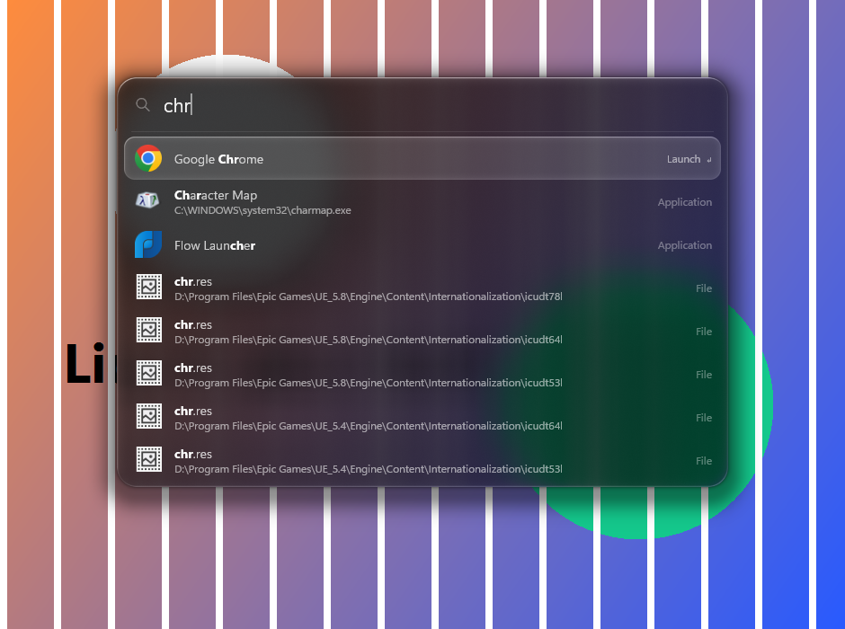

<p align="center">
  
</p>

<h1 align="center">Heimdall</h1>

<p align="center">
  A fast, small, glass launcher for Windows. Press F5, type a few letters, hit Enter.
</p>

<p align="center">
  
</p>

## Why I built it

I wanted something like Spotlight on Windows that opens instantly, finds any file on any drive, and looks good doing it. Flow Launcher is great, but it's a 250 MB .NET app with a plugin system I never used. Everything is incredibly fast, but it's a file list, not a launcher.

Heimdall sits in between. It's two native executables totalling under 2 MB, with no Electron, WebView, .NET or plugin runtime. It searches apps and files, does quick maths, switches windows, and stays out of your way the rest of the time.

## Install

1. Download `Heimdall-1.0.0-x64-setup.exe` from the [latest release](https://github.com/Kryzern/Heimdall/releases/latest) and run it. It installs for your user only, so it doesn't need admin.
2. Press **F5**.

The installer puts Heimdall in `%LOCALAPPDATA%\Programs\Heimdall`, adds it to the Start menu, starts it, and sets it to start with Windows.

### The indexer service (recommended)

Heimdall can index your drives by itself, but the indexer service is much faster and lighter. It reads the NTFS master file table directly, keeps up with changes through the USN journal, and holds the index outside the launcher process. Tick **Install the fast file indexer service** in the installer; it needs one admin prompt.

You can also type `install indexer` into Heimdall. The service is called `HeimdallIndexer` and lives in `C:\Program Files\Heimdall`.

### Uninstall

Uninstall Heimdall from **Settings > Apps**. That stops it, removes the autostart entry and the indexer service, and deletes the program folder. Your settings stay in `%APPDATA%\Heimdall` until you delete that folder.

### Without the installer

The release also has `Heimdall-1.0.0-x64.zip`. Unzip it, then right-click `install.ps1` and choose **Run with PowerShell** (add `-Indexer` from a terminal to install the service too). `uninstall.ps1` removes it again.

## Using it

Type and press Enter. Apps, files, folders and everything below come back in one ranked list. The results you pick move up for the same query next time.

| Type | What happens |
|---|---|
| `chr` | Apps by prefix, word or acronym (`vsc` finds Visual Studio Code) |
| `report ext:pdf` | Files, with filters: `ext:`, `in:`, `type:folder`, `size:>100mb`, `mod:week` |
| `heimdall\src main` | Path fragments: `main` somewhere under a `heimdall\src` folder |
| `2^10 * 3` | Calculator; Enter copies the answer |
| `>` | Open windows; pick one to switch to it |
| `C:\Us` or `~\Doc` | Browse folders; Tab completes |
| `g rust lifetimes` | Web search with a prefix (`g`, `ddg`, `yt`, `gh`, `wiki`, or your own) |
| `lock`, `sleep`, `restart` | System actions; anything destructive asks for a second Enter |

| Key | Action |
|---|---|
| `F5` | Show or hide |
| `Enter` | Open |
| `Ctrl+Enter` | Show in Explorer |
| `Ctrl+Shift+Enter` | Run as administrator |
| `Shift+Space` | Preview: thumbnail, text, or folder contents |
| `Tab` | Put the selected folder's path in the search box |
| `Ctrl+C` | Copy the selected path |
| `Ctrl+Shift+Delete` | Forget the selected item from history |
| `Esc` | Close preview, then clear, then hide |

You can also drag any file result straight into another app.

## Settings

`%APPDATA%\Heimdall\config.toml` is created the first time Heimdall runs. Edit it (or type `settings` in Heimdall), and the changes apply the next time it opens.

```toml
hotkey = "F5"                 # or "Alt+Space", "Ctrl+Shift+K", ...
passthrough = ["chrome.exe"]  # apps where F5 keeps its normal meaning (refresh)
game_mode = true              # release the hotkey while a fullscreen game has focus
theme = "system"              # "dark" or "light"
accent = "system"             # or a colour like "#7C9CFF"
glass = "liquid"              # "auto" follows Windows transparency, "solid" is opaque
width = 680.0
max_results = 8
show_recent = true
start_with_windows = true

[[web]]
key = "g"
name = "Google"
url = "https://www.google.com/search?q={q}"
```

F5 is grabbed system-wide, so add your browser to `passthrough` if you still want F5 to refresh pages there. Type `import flow` to bring over your Flow Launcher web searches.

## The glass

Most glass effects are a blur with a white border. I wanted the panel to feel like an actual piece of glass, which mostly means paying attention to the edges.

- Near the rim, the background is pulled from just outside the panel, so whatever is behind it bends around the border.
- Red and blue split very slightly in that bevel.
- A thin highlight sits on the side of the rim facing a light, and the light follows the selected row.
- The frost darkens or lightens depending on what's behind each pixel, so text stays readable over a white page or a dark wallpaper.
- The selection is a smaller piece of thicker glass with its own rim, sliding between rows on a spring.

All of it is one pixel shader. The desktop behind the panel is captured once when Heimdall opens, mip-mapped on the GPU, and sampled from there. Nothing is drawn unless something changes, so Heimdall uses no CPU or GPU while hidden. It drops to a solid panel on battery saver or over Remote Desktop.

## How it's fast

- **One arena per drive.** Every filename on a volume sits in one contiguous block of bytes, with a lowercase copy at the same offsets. A search is a SIMD substring scan over that block, split across every core.
- **Three stages.** The scan finds candidates, a cheap name score narrows them, and only the best few hundred get their full path built and scored. Folders like `node_modules`, caches and `AppData` rank lower; your Desktop, Documents and Downloads rank higher.
- **Typing narrows.** When `repo` becomes `repor`, Heimdall filters the previous results instead of scanning again.
- **Input comes first.** The window handles every pending key before drawing a frame, and file search runs at lower priority than the UI.
- **No paths in memory.** Each file is a 16-byte entry. Full paths are only built for the rows on screen.

## Benchmarks

`heimdall-bench` (included in the zip) builds the index and times queries against Heimdall's engine and against a running copy of [Everything](https://www.voidtools.com/). These numbers are from my machine: 8 threads, four drives, 3.72 million files, median of 20 runs.

| Query | Matches | Heimdall | Everything |
|---|---:|---:|---:|
| `a` | 2.44 M | 27.2 ms | 23.3 ms |
| `re` | 502 k | 13.9 ms | 15.4 ms |
| `report` | 3,266 | 4.1 ms | 14.4 ms |
| `main.rs` | 76 | 3.4 ms | 13.2 ms |
| `readme` | 11,445 | 4.5 ms | 15.9 ms |
| `node_modules` | 480 | 3.6 ms | 11.4 ms |
| `ext:pdf invoice` | 1 | 3.1 ms | 7.9 ms |

| | Heimdall | Everything 1.5 | Flow Launcher 2.1.3 |
|---|---:|---:|---:|
| On disk | 1.7 MB | 6.1 MB | 247 MB |
| Index memory, 3.72 M files | 287 MB | 342 MB | n/a |

These comparisons aren't perfectly like for like:

- Heimdall's times are measured inside the engine, while Everything's include its IPC round trip.
- Everything returns matches sorted by name. Heimdall returns them ranked, which is the part that actually saves you time.
- The index here was built by the directory-walk fallback. Run the benchmark from an elevated prompt to measure the MFT path.

## Building from source

You need Rust on Windows.

```powershell
git clone https://github.com/Kryzern/Heimdall.git
cd Heimdall
cargo test --workspace
powershell -ExecutionPolicy Bypass -File .\packaging\package.ps1   # writes dist\Heimdall-1.0.0-x64.zip
```

The workspace has four crates:

| Crate | What it is |
|---|---|
| `heimdall` | The launcher: window, input, ranking, Direct3D glass, Direct2D text |
| `heimdall-core` | The index, query language, scoring and the pipe protocol |
| `heimdall-indexer` | The Windows service that reads the MFT and tails the USN journal |
| `heimdall-bench` | The benchmark above |

## Privacy

Nothing leaves your machine. There's no telemetry and no update check, and Heimdall makes no network requests apart from the web searches you open yourself. Usage history is a local JSON file. Like Everything, the indexer service sees filenames across the whole drive, so any local user can search names (not contents).

## License

MIT
